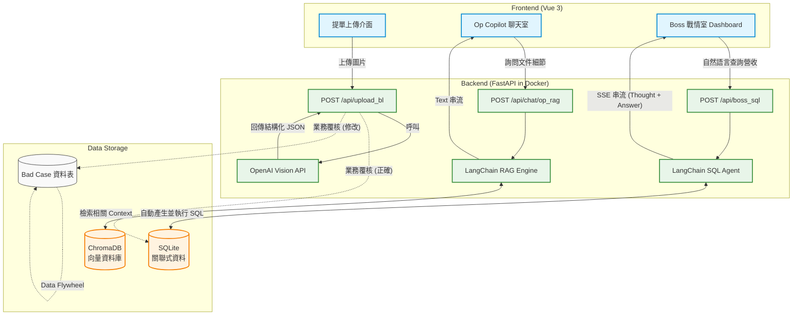

# 🚢 Logistics AI Control Tower (物流 AI 戰情室)

> 將傳統海空運承攬業的紙本作業，轉化為具備 RAG 與 Text-to-SQL 能力的企業級 AI 數據中樞。

[](https://python.org)
[](https://fastapi.tiangolo.com)
[](https://vuejs.org/)
[](https://www.docker.com/)

🔗 **Live Demo (Vercel Frontend)**: [https://logistics.angus41c.dev](https://logistics.angus41c.dev)（亦可用 [2026-07-logistics-ai-control-demo.vercel.app](https://2026-07-logistics-ai-control-demo.vercel.app)）

🔌 **Backend API (Render)**: [https://logistics-ai-backend-nuhv.onrender.com](https://logistics-ai-backend-nuhv.onrender.com)（API 路徑在 `/api` 底下，例如 `/api/bl_list`）

---

## 📖 專案背景與痛點 (Background & Pain Points)

> **💡 專案緣起 (Genesis)**：本專案源自於我過去親自參與的一項物流業諮詢案。在深入了解第一線的作業流程後，我將當時的諮詢洞見與後續展望，轉化為這份以**最小可行性產品 (MVP)** 為基準開發的 **概念驗證 (POC)**。儘管部分邊界功能尚在迭代，但核心架構已完整展示了 Agentic AI 解決產業痛點及營運管理的潛力。

在傳統海空運承攬業的實務運作中，往往面臨以下兩大痛點：
1. **非結構化資料的噩夢**：每天收到來自全球各地、格式不一的提單 (Bill of Lading, B/L) 圖片或 PDF。業務 (OP) 需要耗費大量時間人工辨識、打字輸入系統。
2. **缺乏即時決策數據**：管理層想知道「這季亞洲線的總營收」，往往需要依賴工程師寫 SQL 撈資料，或等財務部門月底的報表，存在嚴重的資料孤島與時間差。

**💡 解決方案：**
本 POC 專案透過導入 Agentic AI 解決上述問題。以 OpenAI Vision 進行文件辨識，以 RAG 技術輔助業務審單，並透過 SQL Agent 賦能管理層使用「自然語言」直接查詢營收數據。

---

## 🚀 快速啟動 (Quick Start)

專案採用「前端本地啟動 + 後端 Docker 容器化」的混合開發模式。

### 先決條件
* 安裝 [Docker Desktop](https://www.docker.com/products/docker-desktop)
* 安裝 [Node.js](https://nodejs.org/) (建議 v18+)

### 1. 後端啟動 (Docker)
後端環境與資料庫 (SQLite / ChromaDB) 已完整容器化。

```bash
# 1. 複製並設定環境變數
cp backend/.env.example backend/.env
# 請在 backend/.env 中填寫您的 OPENAI_API_KEY

# 2. 啟動後端容器 (背景執行)
docker-compose up -d
```
> 後端 API 啟動於 `http://localhost:8000`  
> Swagger 測試文件：`http://localhost:8000/docs`

### 2. 前端啟動 (Vite + Vue 3)
前端使用 Vite 建立，開發 Port 預設為 `3000`。

```bash
# 1. 進入前端目錄
cd frontend

# 2. 安裝依賴套件
npm install

# 3. 啟動開發伺服器
npm run dev
```
> 前端畫面啟動於 `http://localhost:3000`

---

## ✨ 核心功能 (Features)

### 1. Op Copilot
* **OCR 圖片擷取**：上傳提單圖片，自動識別提單號碼、寄件人、收件人與貨物描述。
* **RAG 相關規定知識庫問答**：結合 ChromaDB 向量庫，業務可以直接詢問副駕：「這份提單的卸貨港在哪裡？」，AI 將根據文件內容給予精準答覆。

### 2. Boss Dashboard
* **Text-to-SQL**：管理層可直接在對話框輸入：「*2026 年 10 月各客戶的運費分別是多少？*」（戰情室的預設問題），SQL Agent 會自動分析資料表結構、轉譯為 SQL 語法、查詢 SQLite，並以自然語言回報結果。
* **處理真實資料**：運費帳模擬財務匯出檔的髒資料（客戶別名、多幣別、Credit Note 沖銷、提單號寫法不一、對不上提單的費用）。原樣載入後由 `freight_charges` view 統一整理，並把資料字典（[`backend/data_dictionary/`](backend/data_dictionary/)）注入提示，告訴 Agent 每個欄位的業務意義。
* **安全**：唯讀連線，且在執行期以 sqlglot 白名單檢查每一句 SQL，另有 200 列上限、5 秒逾時與步數限制（[ADR-0005](docs/adr/0005-enforce-sql-agent-whitelist-at-execution.md)）。
* **查詢依據**：每個回答下方附上 Agent 最後一句 SQL 的原始結果表格，數字不經 LLM 轉抄（[ADR-0008](docs/adr/0008-query-evidence-table-from-sql-result.md)）。

### 戰情室評估結果（可量測）

用固定的評估集量測 SQL Agent。判分方式：在獨立的評估資料庫重跑 Agent 最後一句 SQL，結果與從乾淨原始資料算出的標準答案比對，不用 LLM 評審（[ADR-0006](docs/adr/0006-score-eval-by-sql-execution-result.md)）。模型 gpt-4o-mini，每題每組跑 3 次。三個對照組：

* **Raw**：只給原樣載入的髒資料表。
* **Raw + Dictionary**：髒資料表＋資料字典。
* **View + Dictionary**：整理過的 `freight_charges` view＋資料字典（線上戰情室的設定）。

| 題組 | Raw | Raw + Dictionary | View + Dictionary |
|---|---|---|---|
| 主評估集 20 題（7 種陷阱＋6 題只查提單主表的對照題） | 24/60（40%） | 20/60（33%） | **46/60（77%）** |
| 第二組驗證題 8 題（運費總數、差額、比例） | 0/24（0%） | 0/24（0%） | **22/24（92%）** |

* 只給資料字典沒有幫助；把髒資料整理成 view 才是關鍵。
* 每一輪修正都用沒看過的題目驗證，不用找出問題的那組題目證明修好了。例如曾試著改寫「最後一句 SQL 要單獨回答整個問題」的規則用詞，在新題目上從 92% 掉到 50%，因此退回原用詞（記錄在 ADR-0008）。
* 報告：[主評估集](backend/evaluation/results/2026-11-15_1706.md)、[第二組驗證題](backend/evaluation/results/2026-11-16_1400_validation_pre09.md)、[規則試改的量測](backend/evaluation/results/2026-11-16_1359_validation.md)。重跑方式：`cd backend && python -m evaluation.run_eval --set main`（題組：`main`、`holdout`、`validation`）。

### 已知限制與下一步

* **JOIN 後重複加總 (fan-out)**：把運費帳（一張提單多筆費用）JOIN 提單主表後，再加總提單上的欄位（例如報價運費），會被重複計算。下一步是新增 `shipment_billing` view：一張提單一列，報價與請款並排，讓 Agent 不需要自己 JOIN。
* **「報價」被當成請款**：問「報價運費」時，Agent 有時會加總運費帳的請款金額，而不是提單上的 `freight_cost`。同樣由 `shipment_billing` 把兩個欄位並排、名稱分開來解決。
* **把總數拆成明細，或自行加篩選**：只問一個總數時，Agent 偶爾會 `GROUP BY` 拆成多列，或自行只算部分費用代碼。試過改寫規則用詞，量測後反而更差，已退回。
* **判分只看最後一句 SQL**：Agent 分多句查、最後自己心算時，即使摘要正確也會被判錯；反過來，SQL 對但摘要寫錯數字，仍判為正確。

### 3. Data Flywheel
* **Bad Case 收集**：當 AI (OCR) 辨識結果有誤，且經由業務端人工覆核修改後，系統會自動將該筆紀錄標記為 Bad Case，並連同原始圖片與錯誤輸出，獨立寫入資料庫。
* **持續微調**：這套機制為工程團隊提供了最真實的 Edge Case 資料集，供未來 Fine-tuning 模型使用，形成完善的 Data Flywheel 閉環。

---

## 🏗️ 架構與資料流程圖 (Architecture & Data Flow)

本系統將架構分為表現層、AI 邏輯層與資料儲存層。前端透過 RESTful API 與 SSE (Server-Sent Events) 與後端進行通訊。


